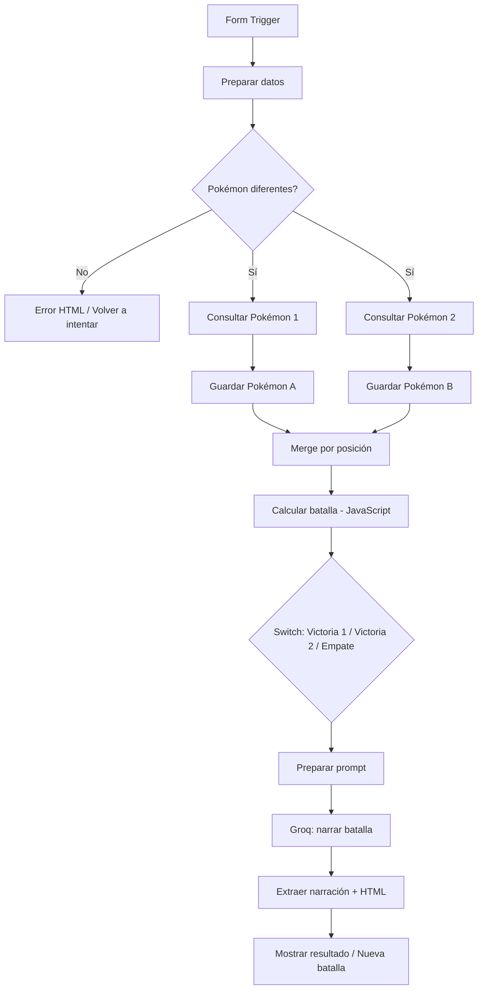

# Pokémon Battle Arena — n8n + PokéAPI + Groq

> Proyecto formativo de IA Engineering, realizado durante un taller de 4Geeks. Versión documentada: v1.1.

## ¿Qué hace?

El usuario selecciona dos Pokémon y un estilo narrativo. El flujo consulta las estadísticas reales mediante PokéAPI, calcula un puntaje simplificado con JavaScript y determina **victoria del Pokémon 1, victoria del Pokémon 2 o empate**. Groq genera una narración en español respetando el resultado. Se muestra una interfaz personalizada en HTML y CSS con imágenes, puntuaciones y navegación para repetir la batalla.

## Arquitectura

## Tecnologías

- **n8n:** orquestación de nodos, formularios, decisiones y peticiones HTTP.
- **PokéAPI:** consulta externa de Pokémon, estadísticas e ilustraciones.
- **JavaScript:** procesamiento de datos, cálculo y creación de HTML.
- **Groq API:** inferencia con un modelo de lenguaje; en la exportación original se configuró `openai/gpt-oss-120b`.
- **HTML/CSS:** presentación visual y botones para repetir la experiencia.

## Regla del taller

`poder = ataque × 2 + defensa + velocidad`

Es una fórmula **didáctica**, no un cálculo oficial de combate Pokémon.

## Pruebas realizadas en la instancia original

| Caso | Ejemplo | Resultado observado |
|---|---|---|
| Gana Pokémon 1 | Pikachu vs. Squirtle | 240 vs. 204; gana Pikachu |
| Gana Pokémon 2 | Bulbasaur vs. Charmander | 192 vs. 212; gana Charmander |
| Empate | Rattata vs. Ekans | 219 vs. 219; empate; narración coherente |
| Entrada inválida | Dos Pokémon iguales | Mensaje personalizado de error |
| Reintento | Botón Volver a intentar | Retorna al formulario inicial |
| Repetición | Botón Nueva batalla | Retorna al formulario inicial |

Las observaciones corresponden a pruebas manuales; no sustituyen pruebas automatizadas ni auditoría de producción.

## Importar el workflow

1. Crea tu propio entorno de n8n y usa la función **Import from File** para seleccionar `pokemon-battle-arena-workflow.json`.
2. Configura una **credencial Bearer Auth** nueva en el nodo `Groq: narrar batalla`. Pega **solo** tu API key de Groq en la credencial, **nunca** dentro del JSON del workflow. No compartas la clave.
3. Verifica que el modelo configurado esté disponible en tu cuenta de Groq.
4. Abre `Simulador de Batallas Pokémon` y copia la **Production URL** que genere tu instancia.
5. Actualiza **dos enlaces** con esa URL: (a) el `href` del botón *Volver a intentar* en `Error: Pokémon iguales`; y (b) `urlNuevaBatalla` en `Extraer narración`.
6. Ejecuta las pruebas manuales antes de publicar y luego publica el workflow.

> **Importante:** los enlaces del JSON público fueron sustituidos deliberadamente por `https://TU-INSTANCIA.n8n.cloud/form/TU-ID-DE-FORMULARIO`. Debes personalizarlos antes de usar los botones. Las credenciales, IDs de instancia y webhook IDs de la versión original se retiraron de la copia destinada al portafolio.

## Limitaciones y mejoras futuras

- El nodo Groq utiliza `On Error: Continue`; si la API falla, muestra un mensaje alternativo. Conviene añadir un manejo explícito de errores y registros de observabilidad.
- Normalizar el campo `estilo` a minúsculas ayudaría a mantener consistencia; actualmente se conserva tal como llega.
- Añadir pruebas automatizadas, validación de disponibilidad de API y controles de costos para un entorno real.
- Evaluar la interfaz en distintos tamaños de pantalla.

## Entrega y demostración

La guía del taller propone una demostración de **3 minutos**: ejecutar una batalla en vivo, explicar una decisión de programación (como `.find()` o `Merge`) y mostrar una mejora propia. La guía no especifica un canal obligatorio de subida; confirma el lugar de entrega con la profesora o en la plataforma de 4Geeks.

## Seguridad

Esta versión de portafolio no contiene el secreto de Groq ni referencias a la credencial guardada en la instancia de origen. No publiques capturas de claves, tokens ni registros sensibles. Para una demostración pública, revisa además los límites y términos de uso de las APIs.
